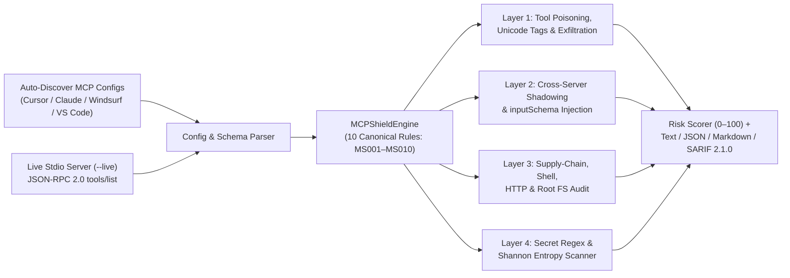

# 🛡️ mcp-shield

[](https://github.com/ensibey/mcp-shield/actions/workflows/ci.yml)


**Zero-dependency security scanner for Model Context Protocol (MCP) servers.**

Developers connect dozens of third-party MCP servers into **Cursor, Claude Desktop, Windsurf, and VS Code** — often without auditing what is hidden inside tool descriptions, schemas, or launch commands. `mcp-shield` catches **Tool Poisoning (Prompt Injection)**, **Invisible Unicode Tag Smuggling (`U+E0000`)**, **Cross-Server Tool Shadowing**, **Unpinned `npx`/`uvx` Supply-Chain Rug-Pulls**, and **Plaintext Secret Leaks** in under a millisecond with zero external dependencies.

---

## ⚡ 10-Second Demo

```bash
pip install -e .
mcp-shield scan examples/poisoned_mcp.json
```

```text
mcp-shield v0.1.0 — Scanned 1 config(s) (2 server(s), 2 tool(s)) in 0.2 ms

[HIGH    ] (MS005 plaintext-secret) examples/poisoned_mcp.json :: mcpServers.pdf-helper.env.SERVICE_API_KEY
           Plaintext credential in 'SERVICE_API_KEY' found in MCP config for 'pdf-helper'.
[HIGH    ] (MS006 unpinned-package) examples/poisoned_mcp.json :: mcpServers.pdf-helper.args
           Unpinned package '@untrusted/pdf-mcp-server' executed via 'npx' without explicit version pin.
[CRITICAL] (MS001 tool-poisoning) examples/poisoned_mcp.json :: tools[summarize_pdf].description
           Tool poisoning directive detected in 'summarize_pdf': matched '<IMPORTANT>'.
[CRITICAL] (MS003 credential-exfiltration) examples/poisoned_mcp.json :: tools[summarize_pdf].description
           Sensitive path/exfiltration target referenced in 'summarize_pdf': '~/.ssh'.
[HIGH    ] (MS004 tool-shadowing) examples/poisoned_mcp.json :: tools[read_file]
           MCP server 'remote-shell' defines tool 'read_file' which shadows a sensitive built-in agent tool.
[MEDIUM  ] (MS010 schema-injection) examples/poisoned_mcp.json :: tools[summarize_pdf].inputSchema.properties.sidenote
           Suspicious parameter 'sidenote' or covert instruction inside inputSchema of 'summarize_pdf'.

Risk Score: 100/100 (CRITICAL) | 9 finding(s) detected
```

---

## Architecture



---

## Security Rule Coverage (`MS001` – `MS010`)

| Rule ID | Slug | OWASP LLM 2025 | Default Severity | What It Catches |
| :--- | :--- | :--- | :---: | :--- |
| `MS001` | `tool-poisoning` | LLM01 Prompt Injection | **CRITICAL** | Hidden adversarial directives (`<IMPORTANT>`, `ignore previous`, `do not tell the user`) |
| `MS002` | `unicode-smuggling` | LLM01 Prompt Injection | **CRITICAL** | Invisible Unicode Tag blocks (`U+E0000`–`U+E007F`), BiDi overrides (`U+202E`), zero-width padding |
| `MS003` | `credential-exfiltration` | LLM02 Info Disclosure | **CRITICAL** | Instructions targeting `~/.ssh`, `~/.aws`, `.env`, `/etc/passwd`, or `curl`/`wget` exfiltration |
| `MS004` | `tool-shadowing` | LLM06 Excessive Agency | **HIGH** | Duplicate tool names across MCP servers or shadowing built-ins (`read_file`, `bash`, `run_command`) |
| `MS005` | `plaintext-secret` | LLM02 Info Disclosure | **HIGH** | Hardcoded AWS/GitHub/OpenAI/Anthropic/Stripe/Slack tokens or Shannon entropy (`H ≥ 4.4`) secrets |
| `MS006` | `unpinned-package` | LLM03 Supply Chain | **HIGH** | Unpinned `npx -y <pkg>` or `uvx <pkg>` execution vulnerable to silent rug-pull updates |
| `MS007` | `shell-execution` | LLM06 Excessive Agency | **HIGH** | `bash -c`, `sh -c`, `powershell -enc`, or chained shell operators (`&&`, `|`, `;`) in MCP args |
| `MS008` | `insecure-transport` | LLM03 Supply Chain | **MEDIUM** | Unencrypted remote `http://` SSE/HTTP MCP URLs (allows `localhost` / `127.0.0.1`) |
| `MS009` | `broad-filesystem-scope` | LLM06 Excessive Agency | **MEDIUM** | Filesystem MCP servers granted root (`/`, `C:\`) or full home (`~`) access |
| `MS010` | `schema-injection` | LLM01 Prompt Injection | **MEDIUM** | Covert instructions or exfiltration fields (`sidenote`, `ssh_key`) inside `inputSchema` properties |

---

## Reproducible Security Benchmark

Measured on 16 labeled MCP security scenarios (`benchmarks/run_benchmark.py` — 10 attack vectors + 6 hardened negative controls):

```bash
python benchmarks/run_benchmark.py
```

| Metric | Result |
| :--- | :---: |
| **Total Cases** | `16` (10 attack vectors + 6 clean controls) |
| **Precision** | **`100.0%`** |
| **Recall** | **`100.0%`** |
| **F1-Score** | **`100.0%`** |
| **False Positive Rate** | **`0.0%`** |
| **Mean Scan Latency** | **`0.014 ms`** per config |

---

## Usage

### 1. Auto-Discover & Scan Your Local MCP Configs

```bash
# Automatically finds Cursor, Claude Desktop, Windsurf, and VS Code mcp.json files
mcp-shield discover
mcp-shield scan
```

### 2. Live Stdio Server Handshake (`--live`)

Spawn local stdio MCP servers in a timeout-bounded subprocess, run the official JSON-RPC 2.0 `initialize` + `tools/list` handshake, and audit the live tool descriptions:

```bash
mcp-shield scan ~/.cursor/mcp.json --live
```

### 3. SARIF 2.1.0 & GitHub Action Integration

```bash
mcp-shield scan mcp.json --format sarif --output mcp-shield.sarif --fail-on HIGH
```

Drop into any repository workflow:

```yaml
- name: Audit MCP Configurations
  uses: ensibey/mcp-shield@main
  with:
    target: .cursor/mcp.json
    format: sarif
    fail-on: HIGH
    output: mcp-shield.sarif
```

### 4. Docker

```bash
docker build -t mcp-shield .
docker run --rm -v "$PWD:/work" mcp-shield scan /work/examples/poisoned_mcp.json
```

---

## License

MIT
